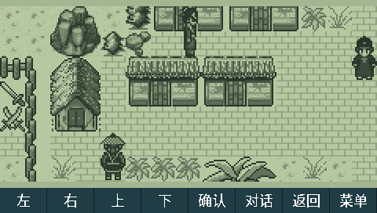
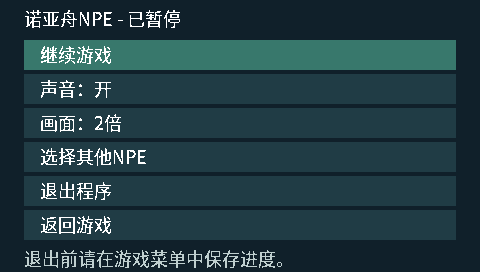
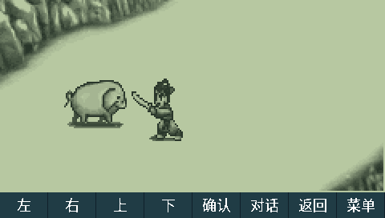
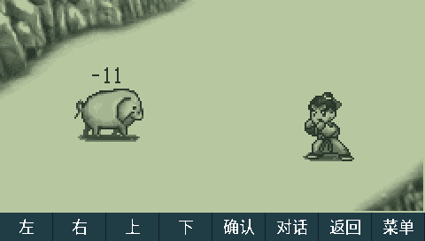
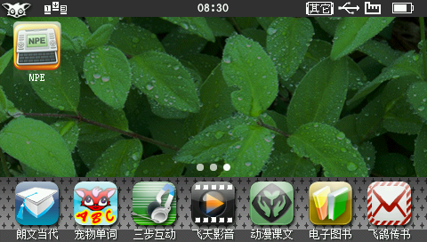

# H1 NPE 引擎移植

将 [noah-npe-engine](https://github.com/HelloClyde/noah-npe-engine) 移植到步步高 H1 / Y100 原生 BDA。
硬件平台参考 [BBKH1-GBA](https://github.com/HelloClyde/BBKH1-GBA)。这是独立的 H1 移植项目。
项目仓库：[HelloClyde/BBKH1-NPE](https://github.com/HelloClyde/BBKH1-NPE)。

H1 桌面和应用列表显示名称为 **诺亚舟NPE**；安装文件名为 `H1NPE.bda`。

## 快速开始

适用于步步高 **H1 / Y100 V1.41 原生 BDA 环境**。
从 [GitHub Releases](https://github.com/HelloClyde/BBKH1-NPE/releases) 下载
`BBKH1-NPE-v0.1.3-install.zip`，安装包包含程序和所需字体，游戏文件需自行准备。
当前版本为预发布，验证范围见本文下方。

解压 `dist/H1NPE-install.zip`，将 `应用` 和 `NPE` 两个文件夹合并到 H1 的 A 盘：

```text
A:\应用\程序\H1NPE.bda
A:\NPE\assets\gbk12-native.bin
A:\NPE\assets\gbk16-native.bin
```

保留这两个字体文件。将自己的 `.npe` 游戏放到 `A:\NPE\` 或其他目录，
启动 `H1NPE.bda` 后通过系统文件选择器选取游戏。取消选择会退出。
存档保存在所选 NPE 所在目录，使用上游按游戏指纹区分的三个 `.npes` 文件。
存档通过游戏内菜单手动保存，退出前请先存档；不会在任意剧情或战斗状态下自动存档。

开发者可按下方“构建”命令初始化子模块、安装固定工具链并生成相同目录结构的本地安装包。

## 截图

以下是完整 H1 V1.41 固件在 QEMU `bbkh1` 中的真实帧缓冲，非真机截图。
游戏画面来自本机《天降风云》测试资源，安装包不包含游戏。

| 地图与触摸操作栏 | 暂停与显示设置 |
| --- | --- |
|  |  |

| 普通攻击姿势 | 伤害数字停留 |
| --- | --- |
|  |  |

| 原生桌面图标 | 未选择文件，退出后返回桌面 |
| --- | --- |
|  |  |

地图、暂停与战斗截图来自 v0.1.3 正式 BDA；战斗从独立测试存档进入。
桌面与取消截图保留早期采集时的 NPE 名称；
当前构建显示名称为“诺亚舟NPE”。
构建身份及截图摘要见 [验证记录](docs/verification.md) 和 `docs/evidence/`。

## 操作

| H1 操作 | 功能 |
| --- | --- |
| 方向键 / I J L M | 移动、选择 |
| 确认 / Enter / Z / K | 确认、调查 |
| 空格 | 对话、翻页 |
| 返回 / X | 游戏菜单、取消（原 F4） |
| P / 触摸底栏“菜单” | 打开中文暂停菜单 |
| Escape | 退出应用 |
| 触摸底栏 | 左、右、上、下、确认、对话、返回、菜单 |

问答模式保留字母输入，包括 Z/X/P；Shift 接入大写输入。方向键长按可重复移动。
默认显示原始 240×120 画面的 2 倍版本 480×240，底部 32 像素为触摸操作栏。
暂停菜单提供“继续游戏”“声音：开/关”“画面：2倍/1倍”“选择其他NPE”“退出程序”“返回游戏”。
方向键选择，确认键执行，也可直接触摸选项；返回键关闭暂停菜单。
暂停菜单停止游戏时钟和 PCM，继续后恢复；关闭声音仍推进音频服务的剧情回调。
中文路径直接使用 H1 的 GBK 字节，目录解析避开 GBK 尾字节中的反斜杠。

## 依赖

使用成品需要 H1 / Y100 V1.41、随安装包附带的两个 GBK 字体和自己的 `.npe` 游戏。
不需要安装 SDL2、PC 运行库、原机固件或开发工具链。

| 开发依赖 | 固定版本与用途 |
| --- | --- |
| [H1 BDA SDK](https://github.com/MrDefinition1999/bbk-h1-bda-sdk) | `vendor/h1-sdk`，提交 `067fe072477861dfc8949d7b1a55279fb92d2548`；H1 接口、打包和校验 |
| [NPE 引擎](https://github.com/HelloClyde/noah-npe-engine) | `third_party/noah-npe-engine`，上游 v0.1.3，提交 `567ae64c1ba67c8a55d0c4fbdf874f9ac58471cf`；GPL-2.0 源码及单独记录来源的原生字体 |
| Windows GNU MIPS 工具链 | GCC 15.2.0；安装器验证归档 SHA256，工具前缀 `mipsel-none-elf-` |
| Python / Git | Python 3.10+；CI 使用 Python 3.12 和 Windows runner，Git 用于固定依赖和源码打包 |
| Pillow | 12.3.0，生成 H1 四份图标资源，锁定于 `requirements.txt` |
| Unicorn | 2.1.4，仅执行 MIPS 自动测试，锁定于 `tests/requirements.txt` |

图标和位图字体均预生成并随源码收录。普通构建无需 imagegen、系统字体或字体生成服务。
字体/图标来源与再生说明分别见 `NOTICE.md`、`assets/README.md` 和固定上游字体来源文件。

## 构建

需要 Python 3.10+、Pillow、Git 和 `mipsel-none-elf-gcc` / `objcopy`。

```powershell
git clone https://github.com/HelloClyde/BBKH1-NPE.git
cd BBKH1-NPE
git submodule update --init
python -m pip install -r requirements.txt
python tools/install_toolchain.py
python tools/build.py --toolchain .tools/toolchain/bin
python tools/check_app_icon.py
```

输出 `dist/H1NPE.bda` 和 `dist/H1NPE-install.zip`。也可通过 `H1_GNU_BIN` 或 `--toolchain`
指定自己的 MIPS 工具链；复现发布版本使用上面固定的 GCC 15.2.0。
完整 Release 源码 ZIP 包含两个固定依赖的全部源码及 `source-manifest.json`，解压后
可直接从安装 Python 依赖这一步开始，构建器验证依赖文件哈希，无需重新拉取子模块。

MIPS 自动测试需要 `tests/requirements.txt` 中的依赖和自己提供的 NPE：

```powershell
python -m pip install -r tests/requirements.txt
python tests/ci_smoke.py
python tests/mips_smoke.py --game '你的游戏.npe'
python tests/error_paths.py --game '你的游戏.npe'
python tools/build.py --toolchain .tools/toolchain/bin --test-new-game
python tests/mips_smoke.py --game '你的游戏.npe' --bda dist/H1NPE-test-new-game.bda --gameplay
python tools/build.py --toolchain .tools/toolchain/bin --test-storage
python tests/mips_smoke.py --game '你的游戏.npe' --bda dist/H1NPE-test-storage.bda --storage
```

`--gameplay` 的菜单序列按《天降风云》初始化状态验证，其他游戏可能需要不同输入。
测试 BDA 会跳过开场或执行存储探针，请使用正式 `H1NPE.bda` 安装包游玩。

依赖锁定于 `.gitmodules` 和构建脚本中的提交；构建器拒绝修改过的依赖。
SDL2 本身不参与 H1 编译。`src/platform/SDL.h` 仅实现本引擎所需的小型 API 子集，
上游前端和音频调度在构建副本中使用 H1 显示、文件、时钟、按键和 PCM 服务。
源码入口为 `src/app.c`；适配层为 `src/platform/sdl_h1.c`。
运行错误及加载过程记录在 `A:\NPE\h1npe.log`。

应用图标使用诺亚舟学习机元素和 H1 高光圆角风格，原图与生成提示词见 `assets/README.md`。
构建会生成 H1 的全部四份菜单图标资源；更新图标不需要在构建时调用图像生成服务。

## 验证状态

交叉编译、BDA 格式校验和运行测试的结果见 `docs/verification.md`。
尚未进行 H1 真机验证；模拟服务和完整固件模拟器的证据分别记录。
游戏兼容性仍受上游引擎实现范围限制。

v0.1.3 同步上游战斗显示等待修复，普通攻击姿势不再快速闪过，伤害/中毒数字保留原服务等待单位。
此次上游未修改存档格式或战斗计算。平安镇郊外的部分出口受剧情进度限制，保持游戏资源中的条件。

## Actions 和发布

`main`、PR 和手动运行构建正式 BDA、检查 GBK 名称/图标/校验和，执行真实 MIPS 的
选择器取消与坏资源路径测试，检查 BDA/安装 ZIP 重复构建一致，并上传临时 artifact。
CI 不携带游戏和固件，因此不会把 CI 成功描述为完整固件或真机测试通过。

`v*` 标签触发 Release；标签须匹配 `VERSION`。发布复用同一次 CI 的构建产物，
下载后校验 `SHA256SUMS.txt`，仅发布 job 具有写入权限。
`v0.1.3` 使用预发布标记，含 BDA、安装 ZIP、完整源码 ZIP、构建/验证信息和 SHA256 清单。
维护者在干净提交上执行 `python tools/package_release.py` 可生成 `dist/release/`。

## 感谢

- HelloClyde：NPE 引擎和 BBKH1-GBA 项目，提供引擎实现及 H1 硬件适配参考。
- MrDefinition1999：H1 BDA SDK、资源格式与原生接口验证资料。
- Noto Sans CJK 字体贡献者：暂停菜单字形的字体来源；游戏内原生字库来源见上游 `FONT-PROVENANCE.txt`。

## 来源与许可

本仓库 H1 适配层、构建/打包脚本及测试按 GPL-2.0 发布，见 `LICENSE` 和 `NOTICE.md`。
NPE 上游的原创引擎、前端、工具和测试源码采用 GPL-2.0-only；许可文本和范围见
`third_party/noah-npe-engine/LICENSE`、`NOTICE.md`。H1 安装包保留上游的许可证与来源说明。
SDK、字体和素材仍分别遵循各自来源；GPL 源码授权不扩展到原机字形、游戏截图或其他第三方资源。
安装包不包含游戏资源。
